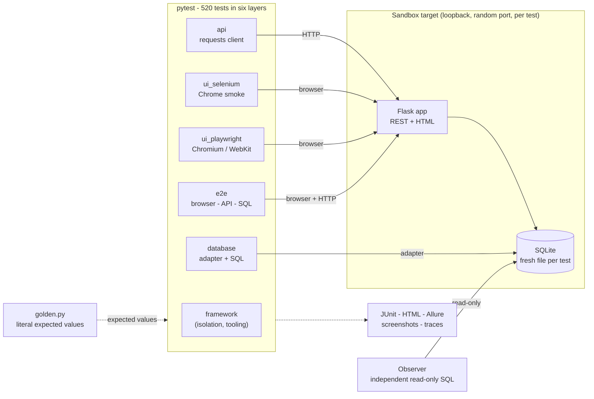
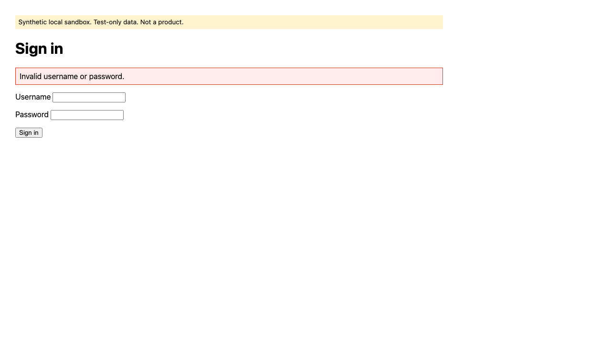
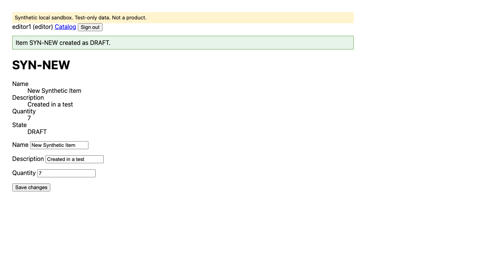
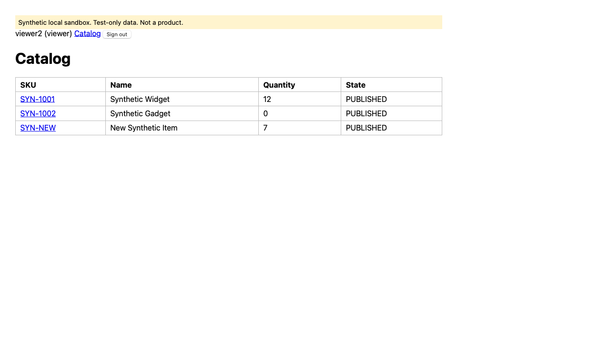
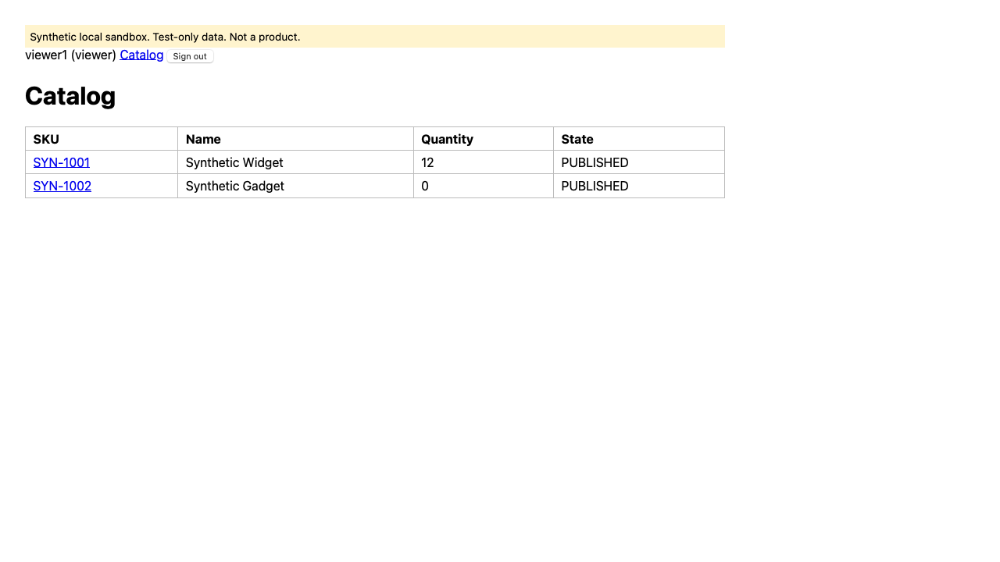
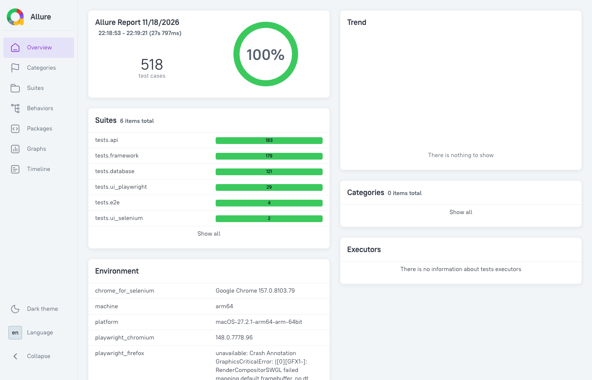

# Catalog QA Automation Lab

A personal QA automation project, originally developed in 2023 and modernized in 2026. It is a Python/pytest suite that tests one small, **local, synthetic** web application - a catalog with login, three roles and a draft-to-published workflow - through a real browser, over real HTTP and directly in SQL. Its focus is trustworthy evidence: independent expected values, proof that rejected requests change nothing, per-test isolation, and a seeded-defect check showing that the tests really catch bugs.

> **Project history.** The original 2023 project was written by the author while taking a QA automation course; the instructor gave general architectural guidance, which is gratefully acknowledged. The 2026 modernization was carried out with AI assistance (Claude); [docs/DEVELOPMENT_HISTORY.md](docs/DEVELOPMENT_HISTORY.md) states plainly what was done and how. This is not commercial experience or a production framework. Limits are listed in [docs/LIMITATIONS.md](docs/LIMITATIONS.md) and in the table below.

## How it evolved

| Stage | What it was | Findings |
|---|---|---|
| **2023 - original project** | an API client, a SQLite helper, a Selenium page object and 22 tests | weaknesses found on review in 2026: results depended on the live internet; a rejected login "proved" by the page title; tests mutated one shared database; hard-coded paths; SQL built with string interpolation; tests that print but cannot fail |
| **2026 - modernization** | a local sandbox target, a test plan and contract written *before* any test code, independent oracles, six test layers, mutation checks, real reports | listed with fixes in [docs/DEVELOPMENT_DEFECTS.md](docs/DEVELOPMENT_DEFECTS.md), including defects found by an external review |
| **Publication candidate (1.0.2)** | this clean snapshot: reproducible installation, evidence sample, CI workflow (not yet run hosted) | see [docs/LIMITATIONS.md](docs/LIMITATIONS.md) |

The story is in [docs/CASE_STUDY.md](docs/CASE_STUDY.md); who did what, including AI involvement, is in [docs/DEVELOPMENT_HISTORY.md](docs/DEVELOPMENT_HISTORY.md).

## Architecture



Text version: tests -> (browser | HTTP | adapter) -> Flask sandbox -> SQLite; an independent read-only `Observer` and literal `golden.py` values provide the oracle, so those checks do not derive their expected values from the implementation under test.

## Technologies and layers

| Layer (`tests/...`) | Tests | What it covers | Tools |
|---|---:|---|---|
| `api` | 185 | the REST contract: roles, check order (401/403/400/404/409), validation boundaries, client failures and malformed responses | pytest, requests |
| `database` | 121 | adapter CRUD/transactions/foreign keys/JOIN, schema constraints, SQLite URI safety | pytest, sqlite3 |
| `ui_playwright` | 29 | user-visible behaviour in a real browser, one isolated context per test | Playwright (Chromium, WebKit) |
| `ui_selenium` | 2 | smoke tests through the historical tool | Selenium 4 + Chrome |
| `e2e` | 4 | complete flows with three independent observations (browser, API, SQL) | Playwright + requests + SQL |
| `framework` | 179 | tests of the test infrastructure itself: isolation and teardown, evidence and report integrity, packaging, CI configuration | pytest |

Also: Flask (target), SQLite, ruff, mypy, pytest-html, Allure, pytest-xdist, coverage, GitHub Actions (configured). All dependencies are free and locked with hashes (`requirements.lock.txt`).

## Demonstration

Real screenshots from the test runs (the same scenarios captured by two engines; nothing is staged):

| Rejected login (Chromium) | Draft created by an editor (Chromium) |
|---|---|
|  |  |

| Viewer sees the published item (WebKit) | Forbidden request changed nothing (WebKit) |
|---|---|
|  |  |

The Allure Overview shows 518 cases for 520 pytest results because Allure groups three parameter variants. The report can be regenerated using [the reporting guide](docs/REPORTING.md).



What a **failing** run leaves behind (screenshot, Playwright trace, JUnit) is in [docs/evidence/diagnostics](docs/evidence/diagnostics/INDEX.json); the full reports are described in [docs/REPORTING.md](docs/REPORTING.md).

## Verified results

All numbers come from real runs recorded in [docs/QA_REPORT.md](docs/QA_REPORT.md) and [docs/MUTATION_REPORT.md](docs/MUTATION_REPORT.md); first-run results, no retries.

| Check | Result | Environment |
|---|---|---|
| Complete suite | **520 passed**, 0 failed, 0 skipped | macOS (Apple Silicon), Python 3.12 |
| Reversed order, shuffled order, one process per layer | all 520 passed each time | same |
| Playwright scenarios (`ui_playwright` + `e2e`) | all passed on **Chromium** and on **WebKit** | same |
| Selenium smoke | passed on Chrome | same |
| Seeded defects (mutation check) | **26 of 26 caught** by an existing assertion, green baselines before and after | same |
| Lint and types | `ruff` and `mypy` clean | same |
| Allure and HTML reports | rendered from the real run | [docs/evidence](docs/evidence) |

Not verified: Playwright **Firefox** (it does not start on the development machine), Linux, Windows, Python 3.11/3.13, and **hosted CI - the workflow has never run**, so there is no CI badge.

## Quick start

```bash
python3.12 -m venv .venv && source .venv/bin/activate          # Python 3.12 for the verified local run
python -m pip install --require-hashes -r requirements.lock.txt
export PLAYWRIGHT_BROWSERS_PATH="$PWD/.pw-browsers"
python -m playwright install chromium webkit                    # add firefox on a machine where it can run
python -m pytest -p no:cacheprovider                            # full suite; requires Google Chrome for Selenium
python -m pytest tests/e2e -q                                   # just the cross-layer flows
python -m pytest --browser webkit tests/ui_playwright tests/e2e # the same scenarios on WebKit
python -m sandbox                                               # start the target by hand, then open the printed URL
python tools/ci_check.py                                        # local lint, typing, and test checks
```

Test-only credentials of the sandbox (for example `viewer1` / `TESTONLY-viewer1`) are listed in [docs/DATA_DICTIONARY.md](docs/DATA_DICTIONARY.md); they are public test data, not secrets.

## Example tests

**API - a forbidden request changes nothing** (`tests/api/test_negative_api.py`):

```python
@pytest.mark.golden("G04")
@pytest.mark.parametrize("sku", ["SYN-2001", "SYN-1001", golden.MISSING_SKU], ids=["draft", "published", "missing"])
def test_g04_viewer_mutations_are_forbidden_and_change_nothing(viewer, observer, sku):
    before = observer.items()

    for label, resp in _all_mutation_attempts(viewer, sku):
        assert resp.status == 403, label
        assert resp.error_code == "forbidden", label

    assert observer.items() == before
```

**UI - publish, then check with a fresh, independent viewer session** (`tests/ui_playwright/test_catalog_ui.py`):

```python
@pytest.mark.golden("G07")
def test_g07_publisher_publishes_and_a_fresh_viewer_session_sees_it(page, new_session, server, sign_in, observer):
    ...
    item.publish_button.click()
    expect(item.state).to_have_text("PUBLISHED")
    assert observer.item("SYN-NEW") == (4, "SYN-NEW", "New Synthetic Item", "Created in a test", 7, "PUBLISHED")

    viewer_page = new_session()
    sign_in(viewer_page, "viewer2")
    catalog = CatalogPage(viewer_page, server.url)
    assert catalog.displayed_skus() == ["SYN-1001", "SYN-1002", "SYN-NEW"]
```

**SQL - a read-only connection must refuse writes** (`tests/database/test_adapter_basics.py`):

```python
def test_readonly_connection_refuses_writes(db_path, observer):
    before = observer.items()
    with Database(db_path, readonly=True) as db:
        with pytest.raises(DatabaseError):
            db.update_item_quantity_by_id(1, 99)
    assert observer.items() == before
```

## CI

[`.github/workflows/ci.yml`](.github/workflows/ci.yml) runs lint/types, the suite on Python 3.11-3.13, and the same browser scenarios on Chromium, Firefox and WebKit; a final gate job fails the workflow if any job failed, and JUnit, HTML, Allure results, screenshots and traces are kept even on failure. **It has been validated against the workflow schema but never executed on a hosted runner.** First-run instructions: [docs/CI_FIRST_HOSTED_RUN.md](docs/CI_FIRST_HOSTED_RUN.md).

## Documents

* Design: [API contract](docs/API_CONTRACT.md), [data dictionary](docs/DATA_DICTIONARY.md), [test plan](docs/TEST_PLAN.md), [test strategy](docs/TEST_STRATEGY.md), [architecture](docs/ARCHITECTURE.md), [specification](docs/SPEC.md)
* Evidence: [QA report](docs/QA_REPORT.md), [traceability](docs/TRACEABILITY.md), [mutation report](docs/MUTATION_REPORT.md), [UAT result](docs/UAT_RESULT.md), [reporting guide](docs/REPORTING.md), [evidence folder](docs/evidence)
* Story and learning: [case study](docs/CASE_STUDY.md), [development history](docs/DEVELOPMENT_HISTORY.md), [defects found](docs/DEVELOPMENT_DEFECTS.md), [learning path](docs/LEARNING_PATH.md), [exercises](docs/EXERCISES.md), [handover](docs/HANDOVER.md), [glossary EN/RU](docs/GLOSSARY_EN_RU.md)
* Limits: [limitations](docs/LIMITATIONS.md), [changelog](CHANGELOG.md)

Licence: none has been chosen yet; until one is added, all rights are reserved by the author.
